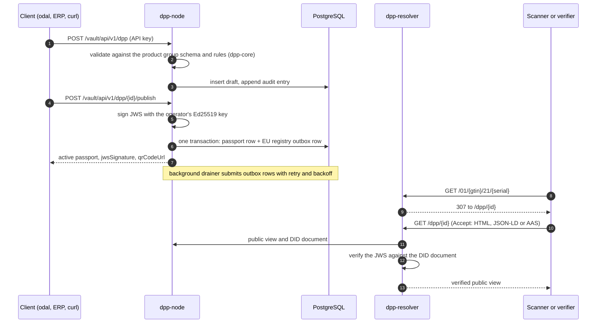

# dpp-engine

The self-hostable node for EU Digital Product Passports (DPPs): an HTTP API that
validates, signs, versions, stores and serves passports from your own
infrastructure. It is source-available under the Business Source License 1.1, and
running it in production for your own organisation's products and compliance
obligations is free. It is built on [`dpp-core`](https://github.com/odal-node/dpp-core),
the Apache-2.0 Rust library that holds the data model, schemas and regulatory rules.

[](LICENSE)
[](https://github.com/odal-node/dpp-engine/actions/workflows/ci.yml)
[](https://www.rust-lang.org/)

> [!NOTE]
> **Status: pre-production.** CI runs the full passport lifecycle against PostgreSQL
> on every change, but no operator runs a node against real product data yet. The
> HTTP API and the database schema still change between minor versions.

## Quick start

From `git clone` to a signed passport that resolves from a GS1 Digital Link. Most of
the time goes into the first build: about 2 minutes for the CLI and 15 to 20 minutes
for the two container images on a 6-core machine. Later starts take seconds.

**You need:** Docker 24+ with Compose v2, Rust 1.96 ([rustup](https://rustup.rs)),
`git`, `curl` and `openssl`. Ports 8001 and 8003 must be free.

> [!NOTE]
> Prebuilt images are not public yet, so the stack is built from source. Keep the
> clone's directory name `dpp-engine`: the Compose build context is its parent
> directory.

### 1. Build the CLI

```bash
git clone https://github.com/odal-node/dpp-engine
cd dpp-engine
cargo build -p dpp-cli --release
export PATH="$PWD/target/release:$PATH"
```

### 2. Configure

```bash
cp .env.example .env
openssl rand -base64 32    # paste as KEY_STORE_PASSPHRASE
openssl rand -hex 16       # paste as ADMIN_PASSWORD
```

In `.env`, set `KEY_STORE_PASSPHRASE`, then uncomment `ADMIN_USERNAME` and
`ADMIN_PASSWORD` and give them values. The example database passwords are accepted
on a local `dev` profile; a `prod` profile refuses them.

### 3. Start the stack

```bash
odal up
odal status
```

```text
SERVICE      URL                                    STATUS   LATENCY
────────────────────────────────────────────────────────────────────────
vault        http://localhost:8001/vault/health     OK       2ms
identity     http://localhost:8001/identity/health  OK       0ms
resolver     http://localhost:8003/health           OK       0ms
```

### 4. Register the operator

`odal` does not read `.env`, so export the admin credentials first. EU registry
registration needs the operator's legal name, and product groups whose passport
obligation is in force also need a default facility and a primary operator
identifier before they publish. The values below are valid test values.

```bash
set -a; . ./.env; set +a
odal bootstrap --legal-name "Example Textiles GmbH" --country DE \
  --address "Musterstrasse 1, 10115 Berlin" --contact-email ops@example.com
odal facility add --name "Berlin plant" --value 4012345000009 --country DE --default
odal operator-id add --scheme vat --value DE123456789 --primary
```

`bootstrap` prints an API key once and saves it to `~/.config/odal/credentials.toml`.
Export it for the `curl` calls below:

```bash
export ODAL_API_KEY=odal_sk_...
```

With a key configured, `odal status` also lists the trust adapters. On a laptop every
one is a stand-in, reported as `ghost`: the passports work end to end, and nothing the
node signs is fit for compliance use. A `production` profile refuses to start this way.

```text
TRUST
profile             development
backup              ghost
compliance          ghost
credential_issuers  ghost
registry_sync       ghost
seal                ghost
...
```

### 5. Create and publish a passport over REST

```bash
curl -s -X POST http://localhost:8001/vault/api/v1/dpp \
  -H "Authorization: Bearer $ODAL_API_KEY" -H 'Content-Type: application/json' \
  -d '{
    "productName": "Organic cotton T-shirt",
    "productGroup": "textile",
    "manufacturer": { "name": "Example Textiles GmbH", "address": "Musterstrasse 1, 10115 Berlin" },
    "productGroupData": {
      "productGroup": "textile",
      "productIdentifier": { "scheme": "gs1", "gtin": "09506000134352" },
      "fibreComposition": [{ "fibre": "organic cotton", "pct": 100.0 }],
      "countryOfOrigin": "PT",
      "careInstructions": "Machine wash 30°C",
      "chemicalComplianceStandard": "OEKO-TEX Standard 100"
    }
  }'
```

The response is the draft, with a server-assigned UUID v7 `id`, `"status":"draft"`
and `"schemaVersion":"1.4.0"`. Publish it:

```bash
export DPP_ID=<id from the response>
curl -s -X POST "http://localhost:8001/vault/api/v1/dpp/$DPP_ID/publish" \
  -H "Authorization: Bearer $ODAL_API_KEY"
```

The passport is now `"status":"active"`, carries an Ed25519 `jwsSignature`, and has a
`qrCodeUrl` of the form `http://localhost:8003/01/09506000134352/21/<serial>`: the GS1
Digital Link printed on the product.

### 6. Resolve it like a scanner

```bash
curl -si http://localhost:8003/01/09506000134352 | head -n 3
curl -s -H 'Accept: application/ld+json' "http://localhost:8003/dpp/$DPP_ID"
curl -s http://localhost:8001/identity/.well-known/did.json
```

The Digital Link answers `307` with a redirect to `/dpp/<id>`. The resolver serves
the public view as JSON-LD, as HTML (open `http://localhost:8003/dpp/<id>` in a
browser), or as an Asset Administration Shell environment, depending on `Accept`.
The DID document holds the public key that verifies the signature.

### 7. Generate and verify the evidence dossier

```bash
odal passport evidence "$DPP_ID"   # prints the stored dossier; its "id" is the last field
odal verify <dossier-id>
```

```text
  [PASS] manifest_signature
  [PASS] content_integrity
  [PASS] full_view_signature
  [PASS] public_view_signature
  [PASS] audit_chain
  [N/A ] transfer_chain — no transfer chain on this passport
  ...
VERIFIED — every check passed.
```

`odal down` stops the stack. Data, including the signing key, stays in Docker
volumes until you remove them.

## How a passport moves through the node



## Architecture

Two binaries, both compiled with `dpp-core`:

| Binary | Port | What it does |
|---|---|---|
| `dpp-node` | 8001 | One Axum process with three route groups: `/vault/*` (passport write engine and lifecycle), `/identity/*` (`did:web` document and signing), `/integrator/*` (CSV/XLSX bulk import). Hosts the Wasm plugin sandbox and the outbox drainers. |
| `dpp-resolver` | 8003 | Public, read-only. Resolves GS1 Digital Links and serves the content-negotiated public view, verifying the signature before it answers. Deployed separately. |
| `odal` | none | The operator CLI: stack lifecycle, onboarding, passports, keys, webhooks, plugins, dossiers. Calls the node's HTTP API. |

| Infrastructure | Port | Role |
|---|---|---|
| PostgreSQL 17 | 5432 | Primary datastore. The app role cannot run DDL, the audit table is append-only (database trigger) and hash-chained |
| Redis 7 | 6379 | Resolver response cache |
| NATS JetStream | 4222 | Event bus. Optional: without `NATS_URL`, events are discarded |

Design points an integrator will meet:

- **Single tenant.** One operator per node, one database, one signing key. Isolation
  between operators is a deployment boundary, not row-level security.
- **Transactional outbox.** The EU registry submission is written in the same
  transaction as the publish, then drained with retry and backoff, so a crash
  between the two loses nothing.
- **Fail-fast startup.** The node refuses to start on sample credentials in any
  profile. Under `NODE_PROFILE=production` it also refuses while a required adapter
  (compliance, seal, EU registry) is a stub. Each adapter's mode is reported on the
  authenticated `GET /vault/api/v1/node/state` and as a `trust_mode` gauge on the
  private metrics listener; the public `/health` reports liveness only.
- **Wasm plugin sandbox.** Product group plugins run under wasmtime with fuel
  metering, a memory cap and no WASI capabilities. Plugins must be signed unless
  `ALLOW_UNSIGNED_PLUGINS=true` under a development profile. A plugin that declares
  the schema versions it supports never receives data outside that range.
- **Errors** are RFC 9457 problem documents on every HTTP surface. IDs are UUID v7.
- **Observability.** Structured logs through `tracing`, Prometheus metrics on a
  private listener (`127.0.0.1:9100` for the node, `9101` for the resolver). There is
  no OpenTelemetry export.

### Crates

| Crate | Kind | Description |
|---|---|---|
| `dpp-node` | bin | The node binary: router, boot checks, outbox drainers, ruleset channel |
| `dpp-vault` | lib, bin | Passport lifecycle (publish, amend, supersede, suspend, retire, end of life), transfer of responsibility, hash-chained audit, evidence dossiers |
| `dpp-identity` | lib, bin | `did:web` documents, signing and key rotation |
| `dpp-resolver` | lib, bin | Public GS1 Digital Link resolver |
| `dpp-render` | lib | The single HTML renderer for the public passport page, shared by the resolver and the pre-rendered continuity snapshot |
| `dpp-integrator` | lib, bin | CSV/XLSX import with per-product-group templates |
| `dpp-dal` | lib | PostgreSQL access through `sqlx`, and the migrations runner |
| `dpp-types` | lib | Operator configuration, auth, audit and API-key types |
| `dpp-common` | lib | Event bus, RFC 9457 errors, metrics, idempotency, outbound URL guard |
| `dpp-plugin-host` | lib | The wasmtime sandbox for product group plugins |
| `dpp-seal` | lib | eIDAS seals behind one port: an experimental local development sealer, or a stub. Also reads stored seals back and checks their issuers against the EU Trusted Lists |
| `dpp-factor-data` | lib | Licensed LCI factor store. Only a stub provider exists; no dataset is licensed |
| `dpp-cli` (`cli/`) | bin | The `odal` CLI |

`dpp-core` crates come from crates.io at the version pinned in the root `Cargo.toml`.
To build against a local `dpp-core` checkout, copy `.cargo/config.toml.example` to
`.cargo/config.toml` (or run `just core-local`).

## Reference

| Topic | Where |
|---|---|
| HTTP API (OpenAPI 3.1) | [`api/openapi.bundled.yaml`](api/openapi.bundled.yaml), browsable at [docs.odal-node.io/api](https://docs.odal-node.io/api/) |
| CLI | [`cli/README.md`](cli/README.md), and `odal <command> --help` |
| Configuration | [`.env.example`](.env.example): every variable, grouped by binary |
| Operating a node | [`docs/guides/OPERATOR-SETUP.md`](docs/guides/OPERATOR-SETUP.md), [`docs/ops/PRODUCTION-RUNBOOK.md`](docs/ops/PRODUCTION-RUNBOOK.md) |
| Developing the engine | [`docs/guides/DEVELOPER-GUIDE.md`](docs/guides/DEVELOPER-GUIDE.md), [`CONTRIBUTING.md`](CONTRIBUTING.md) |
| All engine documents | [`docs/README.md`](docs/README.md) |
| Guides, concepts and regulation | [docs.odal-node.io](https://docs.odal-node.io) |

## Develop

```bash
just infra                  # PostgreSQL, Redis and NATS only
cp .env.example .env
cargo run -p dpp-node
just check                  # the CI gate: format, clippy, guard scripts, unit tests, audit
just test-integration       # the Docker-backed integration tiers
```

## Licence

[Business Source License 1.1](LICENSE). The Additional Use Grant permits production
use to issue, sign, store and serve passports for your own organisation's products and
compliance obligations. Offering the engine to third parties as a hosted or managed
service, or embedding it in a competing product, needs a commercial licence. Each
release converts to Apache-2.0 four years after its release date.
[`docs/legal/LICENSING.md`](docs/legal/LICENSING.md) summarises the terms; the
`LICENSE` file is authoritative.

## Security

Report vulnerabilities privately through **Report a vulnerability** on this
repository's Security tab, or to **security@odal-node.io**. See [SECURITY.md](SECURITY.md).
