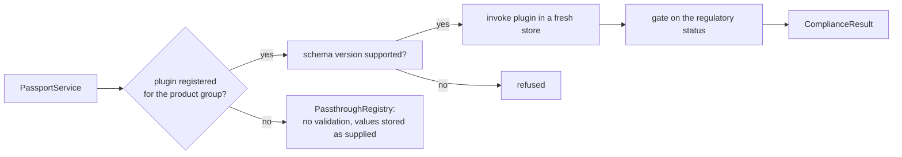

# dpp-plugin-host

The `wasmtime` sandbox that runs product group plugins: WebAssembly modules that
compute compliance results and passport payloads for one product group. Part of
[dpp-engine](../../README.md), under the Business Source License 1.1.

To **write** a plugin, use `dpp-plugin-sdk`; the ABI is defined in
`dpp-plugin-traits`. Both are Apache-2.0 crates in `dpp-core`.

## Sandbox limits

| Limit | Value |
|---|---|
| CPU | Fuel metering, 10,000,000 units per invocation. A plugin that runs out traps |
| Memory | 64 MiB of linear memory. Growth past it is refused |
| WASI | A WASI preview 1 context with no preopened directories, no environment and no sockets. Wall and monotonic clocks are pinned to the moment the store was created |
| Host functions | `odal::log` and `odal::now_ms` (the same pinned time) |

The pinned clock makes a plugin's output a function of its input, so a compliance
result can be reproduced by re-running the same input.

## Loading and signatures

At start-up the node loads every `.wasm` file in `PLUGINS_DIR`; the product group key
comes from the file. Each plugin must carry a detached Ed25519 signature
(`<file>.sig`) that verifies against `PLUGIN_SIGNING_KEY`. Unsigned plugins load only
with `ALLOW_UNSIGNED_PLUGINS=true`, and only under `NODE_PROFILE=development`.

`POST /vault/api/v1/plugins` (`odal plugin install`) installs a signed plugin at
runtime: it is verified, stored and swapped in without a restart.

## Dispatch



- **Schema version check.** A plugin declares the schema versions it supports and is
  never called with data outside them.
- **Regulatory status gate.** After every call, `gate_determination` downgrades the
  result to `NotAssessed` when the product group's act cannot yet bindingly
  determine compliance (for example, a delegated act not yet in force). A plugin
  cannot report `Compliant` or `NonCompliant` for such a group.
- **Passthrough.** With no plugin for a product group, `PassthroughRegistry` stores
  the supplied values without a compliance check. From outside, "no plugin" and
  "checked, no findings" look alike, so the node logs a warning at start-up naming
  every product group that has no plugin loaded.

## Modules

```text
src/
├── host.rs          WasmPluginHost: register, install, hot-swap, dispatch
├── runtime.rs       wasmtime Engine and per-invocation Store (fuel, memory, clocks)
├── sandbox.rs       sandbox limits
├── host_funcs.rs    odal::log, odal::now_ms
└── loader/          discovery, loading and signature verification
```

The `integration-tests` feature enables the `wasm_invoke` benchmark and test helpers.

## Licence

[Business Source License 1.1](../../LICENSE).
