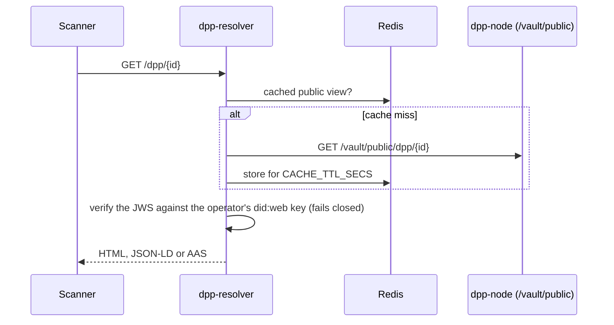

# dpp-resolver

The public reader for Digital Product Passports: it answers scans of a passport's
digital link (a GS1 Digital Link, or the passport's own `/dpp/{id}` address),
verifies each passport's signature against the operator's `did:web` document, and
serves the public view as HTML, JSON-LD or an Asset Administration Shell. It needs
no authentication and runs as its own process, separate from the node. Part of
[dpp-engine](https://github.com/odal-node/dpp-engine), under the Business Source
License 1.1.

> [!NOTE]
> Pre-production. The routes and response shapes can still change between minor
> versions.

## Try it

With the stack from the
[engine quick start](https://github.com/odal-node/dpp-engine#quick-start) running
and a published passport:

```bash
curl -si http://localhost:8003/01/09506000134352 | head -n 3      # 307 to /dpp/<id>
curl -s -H 'Accept: application/ld+json' http://localhost:8003/dpp/<id>
curl -s -H 'Accept: application/aas+json' http://localhost:8003/dpp/<id>
curl -s -o label.png http://localhost:8003/dpp/<id>/qr
```

Open `http://localhost:8003/dpp/<id>` in a browser for the HTML page.

## Routes

| Route | Answers |
|---|---|
| `GET /01/{gtin}`, plus the `/10/{batch}` and `/21/{serial}` forms | A `307` redirect to the passport the label names. Unknown AI combinations under `/01/` are `400` |
| `GET /dpp/{dppId}` | The public view, chosen by `Accept` (below) |
| `GET /dpp/{dppId}/qr` | A QR code PNG for the passport's Digital Link |
| `GET /health`, `GET /ready` | Liveness, and readiness including Redis |

`Accept` on `/dpp/{dppId}`:

| `Accept` | Response |
|---|---|
| `text/html` | The rendered public page ([`dpp-render`](../dpp-render/README.md)) |
| `application/aas+json` | An AAS environment ([`dpp-aas`](https://crates.io/crates/dpp-aas)) |
| `application/ld+json`, `application/json`, `*/*` or none | JSON-LD, with the public JWS attached so a consumer can verify it independently |
| anything else | `406 Not Acceptable` |

The full description, including the AI 22 and AI 235 forms, is in
[`api/openapi.bundled.yaml`](../../api/openapi.bundled.yaml).

## How a request is served



`CACHE_TTL_SECS` (default 30) is also the longest a suspension or correction takes
to reach a scanner, so raise it only with that in mind. The native binary applies a
per-IP fixed-window rate limit (`RATE_LIMIT_RPM`, default 120); health and
readiness probes are exempt.

When `SCAN_INGEST_URL` is set, the resolver counts resolutions per passport, day and
view in memory and flushes the totals to the node over mTLS. No IP address, user
agent or session is recorded. It is off by default.

## Configuration

| Variable | Default | Purpose |
|---|---|---|
| `REDIS_URL` | required | Response cache |
| `RESOLVER_BASE_URL` | required | This resolver's public origin, used for redirects and canonical links |
| `VAULT_BASE_URL` | `http://vault:8001` | The node's vault, for cache misses |
| `OPERATOR_DID_URL` | derived from `VAULT_BASE_URL` | The `did:web` document holding the verification key |
| `CACHE_TTL_SECS` | `30` | Cache lifetime |
| `RATE_LIMIT_RPM` | `120` | Requests per minute from one client address |
| `TRUST_FORWARDED_FOR` | `false` | Count the first address in `X-Forwarded-For` instead of the TCP peer. Set it behind a proxy that is the only way in and replaces that header; see the [production runbook](../../docs/ops/PRODUCTION-RUNBOOK.md#limiting-request-rates) |
| `RESOLVER_PORT` | `8003` | Listening port |
| `METRICS_ADDR` | `127.0.0.1:9101` | Private Prometheus listener. Empty disables it |

The scan-telemetry variables are in the RESOLVER section of
[`.env.example`](../../.env.example).

## Modules

```text
src/
├── main.rs      configuration, rate limiter, cache, metrics, server
├── router.rs    routes and content negotiation
├── handlers/    JSON-LD, HTML, AAS, QR, Digital Link and health handlers
├── infra/       Redis cache, did:web fetch and JWS verification, scan counter
└── domain/      passport id parsing
```

## Licence

[Business Source License 1.1](../../LICENSE).
