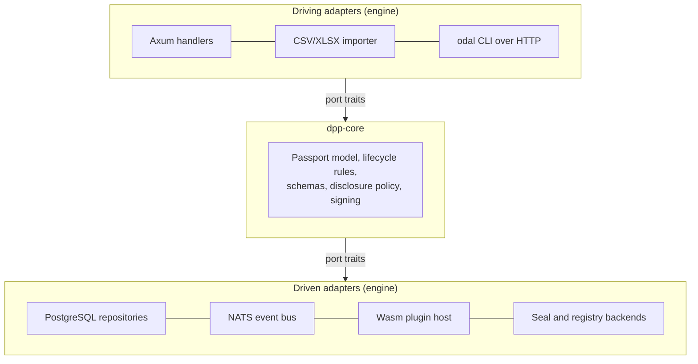

# Design patterns

The patterns that recur across the engine, what each one does, and why it was chosen.

## 1. Ports in core, adapters in the engine

`dpp-core` defines the domain types and the port traits (`PassportRepository`,
`IdentityPort`, `ComplianceRegistry`, `SealPort`, `RegistrySyncPort` and others). The
engine implements every adapter and wires them together; it does not change the
domain.



The test for where code belongs: if it changes because a regulation changed, it goes
in `dpp-core`. If it changes because of how the node is deployed, stored or operated,
it stays here.

## 2. Document repositories

Every PostgreSQL repository in `dpp-dal/src/pg/` stores its entity's full `serde`
JSON in a `doc JSONB` column and copies the fields that queries need into real
columns. Reads deserialise `doc`.

- Field names come from `#[serde(rename_all = "camelCase")]`, so there is no
  hand-written column mapping to keep in sync.
- Indexed columns (status, product group, identifiers, timestamps) serve list
  queries and constraints.
- `api_key` reads through an internal `ApiKeyRow`, because the stored row carries a
  `keyHash` that the public `ApiKey` type does not expose.

[DATA-MODEL.md](DATA-MODEL.md) lists the tables.

## 3. Authentication routed by scheme

`middleware/auth.rs` in `dpp-vault` picks the provider by the `Authorization`
scheme, and a credential only ever reaches the provider for its own scheme:

| Scheme | Provider |
|---|---|
| `Bearer odal_sk_…` | `CompositeAuthProvider`, currently wrapping `ApiKeyAuthProvider` (SHA-256 hash lookup) |
| `Basic base64(user:pass)` | `LocalAuthProvider` (`ADMIN_USERNAME` / `ADMIN_PASSWORD`) |

The split is a security property. `LocalAuthProvider` decodes whatever string it is
given, so if it sat in the Bearer chain, a `Bearer base64(user:pass)` token would
authenticate as admin.

`CompositeAuthProvider` tries its providers in order and returns the first success;
a `Suspended` result stops the chain so no later provider can override it. A future
Bearer-scheme provider (OAuth, for example) is added to that list without touching
the middleware. Details: [AUTH.md](AUTH.md).

## 4. Outboxes

Side effects that leave the node are queued as outbox rows and delivered by a
background drainer in `dpp-node` with retry and backoff. How a row is written depends
on how much a lost row would cost:

| Outbox | Delivers | Written |
|---|---|---|
| `registry_sync` | EU registry registration of a published passport, and later status changes | Registration: in the publish transaction. Status changes (suspend, retire, end of life): after commit |
| `registry_transfer` | Registry notification of a transfer of responsibility | In the accept transaction |
| `seal_outbox` | eIDAS seal requests | After commit. A periodic sweep queues any published passport still unsealed |
| `snapshot_outbox` | Continuity snapshots to object storage | After commit. A periodic sweep re-queues missed reconciles |
| `webhook_delivery` | Signed webhook deliveries | After commit, best effort, alongside the event bus publish |

For the two registry outboxes, a crash between commit and delivery loses nothing:
the row was committed with the passport change. The registration intent is kept
even while the registry adapter is a stub, so switching to a live adapter later
delivers the backlog. Once any row is queued, delivery is retried until it succeeds
or exhausts its attempts.

## 5. Events after commit

Domain events (`dpp.passport.published` and others) are published on the event bus
after the database write commits. A publish failure is logged at `WARN` and never
returned to the caller: the database is the source of truth, and the operation has
already succeeded.

Publishing before the write would leave an event for a change that may then fail.
Publishing after it means an event can be lost if the process dies between commit and
publish, so the obligations that must not be lost (EU registry registration and
transfer notification) are written inside the transaction instead (pattern 4).
Webhook deliveries are queued at the same point as the event publish, so the same
caveat applies to them until the row is queued. See [EVENT-BUS.md](EVENT-BUS.md).

## 6. Versioned event envelope

```json
{
  "version": 1,
  "eventId": "0196f3a2-7c1e-7b3a-9f10-2d4e6c8a0b12",
  "eventType": "dpp.passport.published",
  "timestamp": "2026-05-27T14:30:00Z",
  "operatorId": "self_hosted",
  "data": { "passportId": "…", "status": "active" }
}
```

`version` increases when the payload shape changes, so a consumer can handle old and
new shapes side by side instead of breaking on the release that changes it.

## 7. Stub adapters with reported modes

Optional or not-yet-available dependencies have a stub implementation, so the same
code path runs with or without them:

| Port | Real adapter | Stub |
|---|---|---|
| Event bus | `NatsEventBus` | `NoOpEventBus`: discards events |
| Compliance | Signed Wasm plugin per product group | `PassthroughRegistry`: no compliance check |
| EU registry | Registry HTTP client, when credentials are set | `GhostRegistrySync`: accepts and records nothing remotely. Outbox rows are still written |
| Seal | `SealBackend` chosen by `SEAL_PROVIDER` | `GhostSeal`: no seal |

Each trust-relevant port reports its mode (`live`, `sandbox`, or `ghost` for a stub)
on the authenticated `GET /vault/api/v1/node/state` and as a `trust_mode` gauge on
the private metrics listener. The public `/health` reports liveness only, so it does
not advertise which ports are degraded. Under `NODE_PROFILE=production` the node
refuses to start while a required port resolves to a stub (fail-fast startup
validation).

## 8. One process, nested routers

`dpp-node` nests the vault, identity and integrator routers under one listener and
one PostgreSQL pool:

- **Signing is in-process.** The vault signs through `dpp-vc`'s
  `LocalIdentityService`; the node exposes no signing endpoint.
- **The integrator calls the vault over loopback HTTP**
  (`http://localhost:<NODE_PORT>/vault`), forwarding the caller's API key, so every
  imported row goes through the same validation, scope checks and audit as a direct
  API call.
- **Each service still has its own binary** (`dpp-vault`, `dpp-identity`,
  `dpp-integrator`) and HTTP contract, so a service can be split onto its own host
  later. No deployment does that today.

## 9. Import jobs

Imports of up to 100 valid rows run inside the request. Larger ones return a job id
and run in the background (`queued`, `processing`, `completed` or `failed`); the
client polls `GET /integrator/api/v1/imports/{job_id}`. In the node, jobs live in
PostgreSQL (`PgJobStore`), so they survive restarts; a clean-up task removes finished
jobs older than 30 days. Tests and the standalone integrator use `InMemoryJobStore`.
