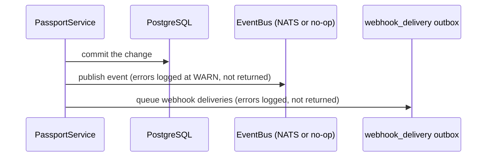

# Event bus

The node publishes a versioned event for each passport and import change. With
`NATS_URL` set, events go to a NATS JetStream stream; without it, they are discarded.
Events are notifications: the database is the source of truth.

## Subscribing

```bash
nats sub 'dpp.>'                 # every event
nats sub 'dpp.passport.>'        # passport events only
```

The node creates the stream on start-up if it does not exist:

| Setting | Value |
|---|---|
| Stream | `DPP_EVENTS` |
| Subjects | `dpp.>` |
| Storage | File (survives a NATS restart) |
| Retention | Limits policy, 7-day maximum age |

For delivery to an HTTP endpoint instead, use signed webhooks
([WEBHOOKS.md](../guides/WEBHOOKS.md)). They carry the same events.

## Subjects

| Subject | Published when |
|---|---|
| `dpp.passport.created` | A draft is created |
| `dpp.passport.updated` | A draft is updated |
| `dpp.passport.published` | A draft is signed and published (status `active`) |
| `dpp.passport.suspended` | A published passport is suspended |
| `dpp.passport.superseded` | `amend` replaces a passport with a corrected successor. The payload carries `successorId`. The `supersede` route, which links an existing successor, publishes no event |
| `dpp.passport.retired` | A passport is retired (terminal) |
| `dpp.passport.deactivated` | End of life is declared (terminal) |
| `dpp.passport.transferred` | A transfer of responsibility is initiated, accepted, rejected or cancelled. The payload's `phase` says which |

`dpp_common::event::subjects` also defines `dpp.passport.failed`,
`dpp.import.completed` and `dpp.import.failed`. Nothing publishes them yet.

The constants in `dpp_common::event::subjects` are the authoritative list.
`just subjects-check` fails the build when a service crate writes a subject as a
string literal instead of using them.

## Envelope

Every event is a `DppEvent`, serialised with camelCase keys:

```json
{
  "version": 1,
  "eventId": "0196f3a2-7c1e-7b3a-9f10-2d4e6c8a0b12",
  "eventType": "dpp.passport.published",
  "timestamp": "2026-05-27T14:30:00Z",
  "operatorId": "self_hosted",
  "data": { "passportId": "…", "status": "active" }
}
```

| Field | Meaning |
|---|---|
| `version` | Envelope and payload version. It increases when the `data` shape changes |
| `eventId` | UUID v7, so ids sort by time |
| `eventType` | The subject |
| `operatorId` | The node's constant operator identity |
| `data` | Subject-specific payload |

## Delivery guarantees



- **No event without a commit.** Events are published after the database commit, so
  a failed write never produces one.
- **An event can be lost.** If NATS is down, or the process stops between commit and
  publish, the event is not sent and is not retried. The operation itself has
  succeeded.
- **An event can arrive more than once.** JetStream consumers can be redelivered a
  message.
- **No ordering across subjects.**

Obligations that must not be lost, such as EU registry registration, do not rely on
the event bus: they are written to an outbox inside the database transaction
([DESIGN-PATTERNS.md](DESIGN-PATTERNS.md#4-outboxes)).

## Consumer guidelines

1. Make handlers idempotent, keyed on `eventId`.
2. Branch on `version` when you depend on the shape of `data`.
3. Treat an event as a prompt to read current state from the API, not as the state.
4. Do not depend on receiving every event; reconcile periodically if you need a
   complete picture.

## The trait

```rust
#[async_trait]
pub trait EventBus: Send + Sync {
    async fn publish(&self, event: &DppEvent) -> Result<(), EventBusError>;
}
```

| Implementation | Location | Behaviour |
|---|---|---|
| `NoOpEventBus` | `dpp-common` | Logs the event at `DEBUG` and discards it. Used when `NATS_URL` is unset |
| `NatsEventBus` | `dpp-node/src/infra/nats_event_bus.rs` | Publishes to JetStream. The node fails to start if `NATS_URL` is set and unreachable |

The trait lives in `dpp-common` because publishing is behaviour; `dpp-types` holds
data only.

## Adding an event

1. Add a constant to `dpp_common::event::subjects`.
2. Emit it from the service method with `self.emit(subjects::YOUR_SUBJECT, data)`.
3. Add it to the table above and to the webhook event list.

The `dpp.>` stream subject already covers any new subject; no NATS change is needed.
