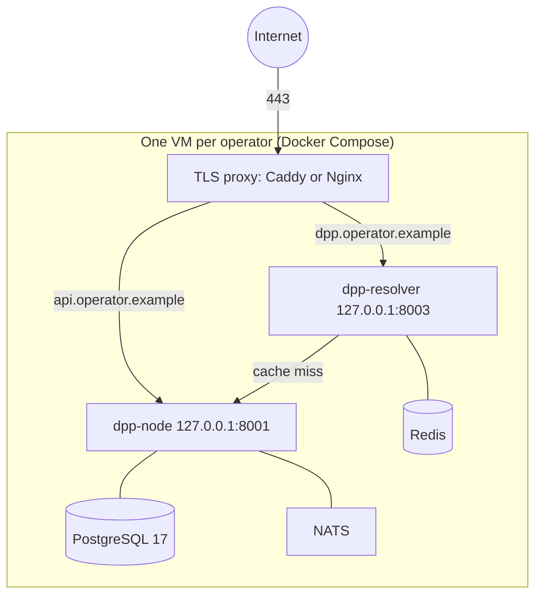

# Production runbook

Running an Odal Node for a real operator: topology, hardening, configuration, go-live
checks, backups, monitoring and upgrades. It assumes the
[operator setup](../guides/OPERATOR-SETUP.md) is understood.

> [!NOTE]
> Pre-production. No node runs against real product data yet, and the schema and API
> still change between minor versions. Treat this as the intended production shape.

## What "production" means today

The node runs under one of three profiles (`NODE_PROFILE`):

| Profile | Starts when | Use it for |
|---|---|---|
| `development` (default) | Always. Stub trust ports are allowed and reported | Pilots and any deployment without a qualified seal provider and EU registry access |
| `sandbox` | No required trust port is a stub; sandbox adapters are accepted | A full rehearsal environment against test authorities |
| `production` | Every required port (compliance, seal, registry sync) is live | Passports that are sealed and registered for real |

`production` refuses to start while the seal or registry adapter is a stub, and the EU
registry is not yet available to connect to. Until it is, every deployment runs the
`development` profile, reports its stubs on `GET /vault/api/v1/node/state` and the
`trust_mode` gauge, and should make no claim of sealed or registered passports. Do not
weaken the start-up check to get to `production`.

Keep `sandbox` as a separate environment, never a mode a production node switches into,
so a test certificate can never seal a passport presented as real.

## Reference topology: one VM per operator



- **The node is single-tenant.** One VM per operator puts the isolation boundary at the
  machine, with no shared data path. A second operator is a second VM with the same
  Compose file.
- **The stack is the shipped `docker/docker-compose.yml`:** PostgreSQL 17, Redis, NATS,
  node and resolver, with volumes `pg-data`, `node-data` (the signing key),
  `node-plugins`, `redis-data` and `nats-data`.
- **Sizing:** a small VM (2 vCPU, 4 GB RAM, 40 GB disk) is a reasonable starting
  point for one operator. Measure before you scale.
- **Region:** place the VM and its backups in the EU if data residency matters to the
  operator.

An orchestrator such as Kubernetes adds little here: its value is packing tenants onto
shared machines, which this design rules out.

## Bring-up

### 1. Names

Use two hostnames on the operator's domain:

| Host | Serves | Public |
|---|---|---|
| `api.operator.example` | The node: the operator API and `/.well-known/did.json` | The DID document must be public; restrict the API by network if you can |
| `dpp.operator.example` | The resolver, which QR codes point at | Yes |

`DID_WEB_BASE_URL` is the origin that serves `/.well-known/did.json`, and
`RESOLVER_BASE_URL` is the QR code origin. Both are effectively permanent: the DID
identifies the signer, and the resolver URL is signed into every passport. Decide them
before the first publish.

### 2. Harden the VM

- SSH keys only (`PasswordAuthentication no`), a non-root user in the `docker` group.
- Firewall: allow 22, 80 (ACME) and 443; deny the rest.
- `fail2ban` and unattended security upgrades.
- **Bind the containers to loopback**, so only the proxy reaches them. The shipped
  Compose file publishes on all interfaces; change the two mappings. The resolver's
  per-address limit relies on this too (see
  [Limiting request rates](#limiting-request-rates)):

  ```yaml
  node:
    ports: ["127.0.0.1:${NODE_PORT:-8001}:8000"]
  resolver:
    ports: ["127.0.0.1:${RESOLVER_PORT:-8003}:8003"]
  ```

### 3. TLS proxy

```caddyfile
api.operator.example {
    reverse_proxy 127.0.0.1:8001
}
dpp.operator.example {
    reverse_proxy 127.0.0.1:8003
}
```

Caddy obtains and renews the certificates.

#### Limiting request rates

The node limits one thing itself: how many bulk imports run at once.
`IMPORT_MAX_CONCURRENT` (default 2) is checked after the caller is authenticated and
before the upload is read. An import that finds no free slot gets `429` with a
`Retry-After`, and `import_rejections_total{reason="busy"}` counts it. An import over
100 rows keeps its slot while its background job runs, so the `202` does not free it,
and an upload that has not arrived after 120 seconds is refused with `400` and gives
its slot back. An upload over 5 MiB is refused with `400` as it is read. A request
that carries an `Idempotency-Key` is admitted the same way, ahead of the idempotency
layer, so a keyed upload is held to the same cap, deadline and size limit as an
unkeyed one. `BATCH_CONCURRENCY` bounds the rows one import writes at a time.

**The node does not limit request rates.** The public passport reads, the credential
read (which is unauthenticated and fetches the issuer's DID document) and the
authenticated API accept whatever reaches them. Set per-address and per-credential
rates in front of the node, at the proxy or a network service. The node does not read
`X-Forwarded-For`, so a limit inside it would see one address, the proxy's.

**The resolver does limit per address.** It allows `RATE_LIMIT_RPM` requests a minute
from one address (default 120, in a fixed one-minute window), answers the rest with
`429` and `Retry-After: 60`, and counts them in `rate_limit_rejections_total`. Health
and readiness probes are exempt. Compose passes `RATE_LIMIT_RPM` and
`TRUST_FORWARDED_FOR` from `.env` to the resolver container, with those defaults.

Which address it counts is the decision to make. With `TRUST_FORWARDED_FOR` unset or
`false` it counts the TCP peer, which behind the proxy is the proxy: every visitor
shares one `RATE_LIMIT_RPM` budget, so the whole public gets 120 requests a minute.
**Set `TRUST_FORWARDED_FOR=true` in `.env` for this topology.** The resolver then counts
the last address in `X-Forwarded-For`, the one the proxy put there. That is safe only
when both of these hold:

- **The proxy is the only way in.** With the resolver port bound to loopback (step 2)
  it is. A client that can reach the resolver directly can send any `X-Forwarded-For`
  and take a fresh budget on every request.
- **The proxy sets the header.** It may replace what the client sent or add to it:
  either way its own entry is the last, and that is the one counted. Caddy's
  `reverse_proxy` replaces it by default and adds to it when the connecting address is
  in `trusted_proxies` (checked on Caddy 2.11). nginx does either, with
  `proxy_set_header X-Forwarded-For $remote_addr;` or `$proxy_add_x_forwarded_for`. A
  proxy that passes the client's header through untouched makes the count the
  client's choice. If a proxy adds its entry as a separate header line, the last line
  is the one read.

Behind a CDN or another proxy in front of yours, the last entry is that proxy's
address, not the visitor's, so visitors who arrive through the same address share one
budget. Limit at that layer instead.

To check it behind your proxy, send ten more requests than the limit from one machine,
inside one minute, then one request from a second machine. Set `LIMIT` to your
`RATE_LIMIT_RPM` and `URL` to a published passport's address:

```bash
LIMIT=120
URL='https://dpp.operator.example/dpp/<a-published-id>'
for i in $(seq $((LIMIT + 10))); do
  curl -s -o /dev/null -w '%{http_code}\n' "$URL"
done | sort | uniq -c
```

The first machine sees `429` for the requests past `LIMIT`, and the second machine's
request must not. If it does, the resolver is counting the proxy's address.

For the limits you set in front of the node:

- **Caddy** has no rate-limiting handler in its standard build. The usual one is a
  third-party module compiled in with `xcaddy`, which is not part of the Caddy
  project and keeps its counters in memory only. A custom build is also not updated by
  the distribution's package, so you take on patching Caddy yourself.
- **nginx** limits requests with `limit_req_zone` and `limit_req`, and `limit_conn`
  bounds open connections. Return `429` with `limit_req_status`.

Whichever you use, test it: send more than the limit and confirm the extra requests are
refused, since a limit that was never exceeded is untested.

### 4. Configuration

`.env` is the contract between you and the node. Set `chmod 600 .env`.

| Variable | Required | Guidance |
|---|---|---|
| `DATABASE_POSTGRES_PASS`, `DATABASE_APP_PASS` | Yes | 32+ random characters each |
| `KEY_STORE_PASSPHRASE` | Yes | Generated; kept in a password manager and in a sealed offline copy. Losing it loses the signing identity |
| `DID_WEB_BASE_URL` | Yes | `https://api.operator.example` |
| `RESOLVER_BASE_URL` | Yes | `https://dpp.operator.example` |
| `KEY_STORE_PATH` | Set by Compose | Leave it on the `node-data` volume; anywhere else, a container recreate generates a new key |
| `ADMIN_USERNAME`, `ADMIN_PASSWORD` | For onboarding | Remove them once API keys exist, unless you want the recovery path available |
| `ODAL_VERSION` | Yes | A release number without the tag's `v` (tag `v0.14.0` is image `0.14.0`). Never `latest`. Record the image digest you deploy, and pin the PostgreSQL image digest too |
| `NODE_PROFILE` | No | Leave unset (`development`) until every required trust port can be live. A value that is not exactly `development`, `sandbox` or `production` stops the node at boot |
| `TRUST_FORWARDED_FOR` | For the reference proxy | `true`, so the resolver rate-limits each visitor and not the proxy. Only with the resolver bound to loopback and a proxy that sets `X-Forwarded-For`; see [Limiting request rates](#limiting-request-rates) |
| `RATE_LIMIT_RPM` | No | Requests a minute per address at the resolver. Default 120 |
| `METRICS_ADDR` | No | Keep on loopback. See [METRICS-PLAN.md](METRICS-PLAN.md) |
| `PLUGINS_DIR` | Set by Compose (`/plugins`) | Put the signed product group `.wasm` files and their `.sig` files on the `node-plugins` volume, and set `PLUGIN_SIGNING_KEY` |
| `RULESET_BUNDLE_PATH`, `RULESET_PUBLISHER_PUBKEY` | No | Both or neither. A bad bundle keeps the last good one and increments `ruleset_load_failures_total`. A new bundle is taken within `RULESET_POLL_INTERVAL_SECS` (default 300), or at once with `odal ruleset reload` |
| `DATABASE_MIGRATE_URL` | No | With it, migrations run at every start. For a stricter setup, start once with it set to apply migrations, then remove it so the long-running node holds only the application role |
| `CORS_ALLOWED_ORIGINS` | No | Only a browser front end's origin |
| `SEAL_*` | No | Sealing is experimental. Leave it unset, or use `SEAL_PROVIDER=local` to exercise the seal paths with clearly unqualified seals |
| `EU_REGISTRY_*`, `BACKUP_S3_*`, `SNAPSHOT_*` | No | Leave unset until the service exists; see `.env.example` |

### 5. First start

```bash
docker compose -f docker/docker-compose.yml up -d
```

With `ODAL_VERSION` pinned this runs the published images; add `--build` to compile the
same Dockerfiles from the checked-out source. On first start PostgreSQL runs
`ops/bootstrap/` (which creates the `odal_app` role), the node applies the migrations,
and the health checks turn green. Then onboard as in the
[operator setup](../guides/OPERATOR-SETUP.md#3-onboard).

### 6. Go-live checks

Do all seven and record the results. They are also the baseline for later incidents.

1. Call the authenticated `GET /vault/api/v1/node/state` and confirm `profile`, each
   port's `trustMode`, and `rulesetVersion`. The public `/health` only answers
   `{"status":"ok"}`, so a probe there checks nothing else.
2. Create and publish a test passport with an API key.
3. Resolve it on the resolver host as JSON-LD and as HTML; the signature must verify.
4. Scan its QR code with a phone on mobile data, not the VM's network.
5. Tamper test: change a field of the published passport directly in PostgreSQL. The
   resolver must answer `409`.
6. Verify the audit trail is intact (generate a dossier and `odal verify` it).
7. Stop the node during a publish and restart it. The registry outbox row must still be
   there.

## Day-2 operations

### Backups

Back up two things, together and off the VM:

- `pg_dump -Fc` of the `odal` database, nightly.
- `keystore.enc` from the `node-data` volume.

Send both to versioned object storage with a retention period. Never store
`KEY_STORE_PASSPHRASE` beside them. Redis and NATS hold caches and replayable events;
leave them out.

**Restore monthly** on a scratch VM: restore the dump and the key store, start the node,
and check that an old passport still resolves and verifies. Aim for under an hour. An
untested backup is not a backup.

### Monitoring

| Probe | Where it runs | What it can check |
|---|---|---|
| External uptime check on `https://dpp.operator.example/health` and one known passport | Any uptime service | Liveness only. Do not give an external service an API key: even a `read` key reads every passport |
| `trust_mode` and the other series on the metrics listener | On the VM (Prometheus, or a cron job reading `/metrics`) | Trust mode per port, signing failures, outbox backlogs, ruleset failures. Needs no credential |

Alert at least on: `trust_mode` below its expected value for any port,
`signing_failures_total` increasing, `registry_outbox_stalled > 0`,
`ruleset_load_failures_total` increasing, and disk above 80%. Rules are in
[METRICS-PLAN.md](METRICS-PLAN.md#starter-alert-rules).

### Upgrades

1. Back up. Migrations only go forward, so the backup is the rollback.
2. Bump `ODAL_VERSION` on a staging VM and run go-live checks 1 to 3.
3. Repeat on production.
4. Compare `rulesetVersion` on `/vault/api/v1/node/state` before and after.
5. Record the upgrade (version, digest, date, result) for the operator.

### Signing key rotation

The identity service rotates keys without breaking old signatures. Each key is named by
its own thumbprint, and a JWS's `kid` is the absolute URL of the verification method that
signed it, so `dpp-crypto` resolves archived keys by `kid` as well as the current one.
The test `signature_signed_before_rotation_still_verifies_after` in `dpp-identity`
covers this. Follow the archive-then-generate order documented on
`rotate_key_handler`.

### The DID domain is a trust root

A passport is verified against the operator's `did:web` document, which is fetched
over HTTPS from the operator's domain. Whoever controls that domain's DNS records or
its TLS endpoint can change which keys the document names, and so which signatures
verify. The resolver caches a fetched document for five minutes. Nothing in the node
detects a changed document today, and a verifier that trusts only the document trusts
your DNS. Protect the domain accordingly:

- Turn on the registrar's transfer lock and two-factor sign-in for the registrar and
  the DNS provider, and keep the number of people with access small.
- Sign the zone (DNSSEC) where the registrar supports it.
- Publish CAA records that name the certificate authority you use, so no other issuer
  is asked to certify the domain.
- After every key rotation, fetch your DID document and record the thumbprints it
  names. Compare a fresh fetch against that record on a schedule and treat a
  difference you did not make as an incident.

### Key custody

Decide and write down who holds `KEY_STORE_PASSPHRASE`:

- **The operator holds it** and enters it at provisioning. Whoever runs the VM cannot
  sign without them.
- **The administrator holds it** in a password manager, with a sealed offline copy.

Either way, the custody arrangement belongs in the operator's records.

What protects the key while the node runs:

- The key store is an encrypted file (AES-256-GCM, key derived from the passphrase
  with Argon2id). The node reads the passphrase from the `KEY_STORE_PASSPHRASE`
  environment variable and nowhere else, so anyone who can read the node's
  environment (`docker inspect`, the Compose file, a copy of `.env`) holds the
  passphrase, and the encrypted file plus the passphrase is the signing identity.
- Keep `.env` readable by the deploy user only (mode `0600`), keep it out of
  version control, and keep it out of any backup that leaves the host. Back up the
  key store file and the passphrase separately.
- The decrypted key is held in the node's memory. There is no hardware-backed or
  remote-signer option today, so a host compromise is a key compromise. Rotate the
  key if the host may have been exposed.

## Go-live checklist

- [ ] Hostnames and the DID origin decided
- [ ] VM hardened; node and resolver bound to loopback
- [ ] TLS live on both hosts; `/.well-known/did.json` reachable publicly
- [ ] `.env` complete, `chmod 600`, secrets in a manager with a sealed offline copy
- [ ] `ODAL_VERSION` and the PostgreSQL image pinned; digests recorded
- [ ] First start green
- [ ] All seven go-live checks recorded
- [ ] Backup job running, first restore drill done and dated
- [ ] External liveness probe and on-VM `trust_mode` alerting in place
- [ ] Upgrade procedure and key custody written into the operator's records
