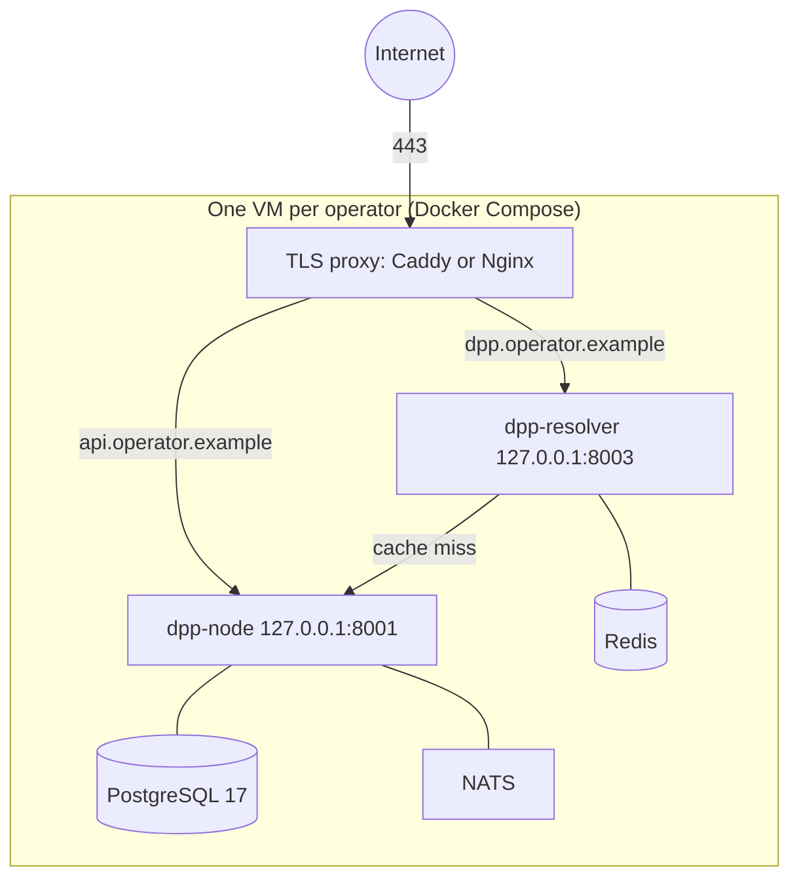

# Production runbook

Running an Odal Node for a real operator: topology, hardening, configuration, go-live
checks, backups, monitoring and upgrades. It assumes the
[operator setup](../guides/OPERATOR-SETUP.md) is understood.

> [!NOTE]
> Pre-production. No node runs against real product data yet, and the schema and API
> still change between minor versions. Treat this as the intended production shape.

## What "production" means today

The node runs under one of three profiles (`NODE_PROFILE`):

| Profile | Starts when | Use it for |
|---|---|---|
| `development` (default) | Always. Stub trust ports are allowed and reported | Pilots and any deployment without a qualified seal provider and EU registry access |
| `sandbox` | No required trust port is a stub; sandbox adapters are accepted | A full rehearsal environment against test authorities |
| `production` | Every required port (compliance, seal, registry sync) is live | Passports that are sealed and registered for real |

`production` refuses to start while the seal or registry adapter is a stub, and the EU
registry is not yet available to connect to. Until it is, every deployment runs the
`development` profile, reports its stubs on `GET /vault/api/v1/node/state` and the
`trust_mode` gauge, and should make no claim of sealed or registered passports. Do not
weaken the start-up check to get to `production`.

Keep `sandbox` as a separate environment, never a mode a production node switches into,
so a test certificate can never seal a passport presented as real.

## Reference topology: one VM per operator



- **The node is single-tenant.** One VM per operator puts the isolation boundary at the
  machine, with no shared data path. A second operator is a second VM with the same
  Compose file.
- **The stack is the shipped `docker/docker-compose.yml`:** PostgreSQL 17, Redis, NATS,
  node and resolver, with volumes `pg-data`, `node-data` (the signing key),
  `node-plugins`, `redis-data` and `nats-data`.
- **Sizing:** a small VM (2 vCPU, 4 GB RAM, 40 GB disk) is a reasonable starting
  point for one operator. Measure before you scale.
- **Region:** place the VM and its backups in the EU if data residency matters to the
  operator.

An orchestrator such as Kubernetes adds little here: its value is packing tenants onto
shared machines, which this design rules out.

## Bring-up

### 1. Names

Use two hostnames on the operator's domain:

| Host | Serves | Public |
|---|---|---|
| `api.operator.example` | The node: the operator API and `/.well-known/did.json` | The DID document must be public; restrict the API by network if you can |
| `dpp.operator.example` | The resolver, which QR codes point at | Yes |

`DID_WEB_BASE_URL` is the origin that serves `/.well-known/did.json`, and
`RESOLVER_BASE_URL` is the QR code origin. Both are effectively permanent: the DID
identifies the signer, and the resolver URL is signed into every passport. Decide them
before the first publish.

### 2. Harden the VM

- SSH keys only (`PasswordAuthentication no`), a non-root user in the `docker` group.
- Firewall: allow 22, 80 (ACME) and 443; deny the rest.
- `fail2ban` and unattended security upgrades.
- **Bind the containers to loopback**, so only the proxy reaches them. The shipped
  Compose file publishes on all interfaces; change the two mappings:

  ```yaml
  node:
    ports: ["127.0.0.1:${NODE_PORT:-8001}:8000"]
  resolver:
    ports: ["127.0.0.1:${RESOLVER_PORT:-8003}:8003"]
  ```

### 3. TLS proxy

```caddyfile
api.operator.example {
    reverse_proxy 127.0.0.1:8001
}
dpp.operator.example {
    reverse_proxy 127.0.0.1:8003
}
```

Caddy obtains and renews the certificates.

### 4. Configuration

`.env` is the contract between you and the node. Set `chmod 600 .env`.

| Variable | Required | Guidance |
|---|---|---|
| `DATABASE_POSTGRES_PASS`, `DATABASE_APP_PASS` | Yes | 32+ random characters each |
| `KEY_STORE_PASSPHRASE` | Yes | Generated; kept in a password manager and in a sealed offline copy. Losing it loses the signing identity |
| `DID_WEB_BASE_URL` | Yes | `https://api.operator.example` |
| `RESOLVER_BASE_URL` | Yes | `https://dpp.operator.example` |
| `KEY_STORE_PATH` | Set by Compose | Leave it on the `node-data` volume; anywhere else, a container recreate generates a new key |
| `ADMIN_USERNAME`, `ADMIN_PASSWORD` | For onboarding | Remove them once API keys exist, unless you want the recovery path available |
| `ODAL_VERSION` | Yes | A release number without the tag's `v` (tag `v0.14.0` is image `0.14.0`). Never `latest`. Record the image digest you deploy, and pin the PostgreSQL image digest too |
| `NODE_PROFILE` | No | Leave unset (`development`) until every required trust port can be live |
| `METRICS_ADDR` | No | Keep on loopback. See [METRICS-PLAN.md](METRICS-PLAN.md) |
| `PLUGINS_DIR` | Set by Compose (`/plugins`) | Put the signed product group `.wasm` files and their `.sig` files on the `node-plugins` volume, and set `PLUGIN_SIGNING_KEY` |
| `RULESET_BUNDLE_PATH`, `RULESET_PUBLISHER_PUBKEY` | No | Both or neither. A bad bundle keeps the last good one and increments `ruleset_load_failures_total`. A new bundle is taken within `RULESET_POLL_INTERVAL_SECS` (default 300), or at once with `odal ruleset reload` |
| `DATABASE_MIGRATE_URL` | No | With it, migrations run at every start. For a stricter setup, start once with it set to apply migrations, then remove it so the long-running node holds only the application role |
| `CORS_ALLOWED_ORIGINS` | No | Only a browser front end's origin |
| `SEAL_*` | No | Sealing is experimental. Leave it unset, or use `SEAL_PROVIDER=local` to exercise the seal paths with clearly unqualified seals |
| `EU_REGISTRY_*`, `BACKUP_S3_*`, `SNAPSHOT_*` | No | Leave unset until the service exists; see `.env.example` |

### 5. First start

```bash
docker compose -f docker/docker-compose.yml up -d
```

With `ODAL_VERSION` pinned this runs the published images; add `--build` to compile the
same Dockerfiles from the checked-out source. On first start PostgreSQL runs
`ops/bootstrap/` (which creates the `odal_app` role), the node applies the migrations,
and the health checks turn green. Then onboard as in the
[operator setup](../guides/OPERATOR-SETUP.md#3-onboard).

### 6. Go-live checks

Do all seven and record the results. They are also the baseline for later incidents.

1. Call the authenticated `GET /vault/api/v1/node/state` and confirm `profile`, each
   port's `trustMode`, and `rulesetVersion`. The public `/health` only answers
   `{"status":"ok"}`, so a probe there checks nothing else.
2. Create and publish a test passport with an API key.
3. Resolve it on the resolver host as JSON-LD and as HTML; the signature must verify.
4. Scan its QR code with a phone on mobile data, not the VM's network.
5. Tamper test: change a field of the published passport directly in PostgreSQL. The
   resolver must answer `409`.
6. Verify the audit trail is intact (generate a dossier and `odal verify` it).
7. Stop the node during a publish and restart it. The registry outbox row must still be
   there.

## Day-2 operations

### Backups

Back up two things, together and off the VM:

- `pg_dump -Fc` of the `odal` database, nightly.
- `keystore.enc` from the `node-data` volume.

Send both to versioned object storage with a retention period. Never store
`KEY_STORE_PASSPHRASE` beside them. Redis and NATS hold caches and replayable events;
leave them out.

**Restore monthly** on a scratch VM: restore the dump and the key store, start the node,
and check that an old passport still resolves and verifies. Aim for under an hour. An
untested backup is not a backup.

### Monitoring

| Probe | Where it runs | What it can check |
|---|---|---|
| External uptime check on `https://dpp.operator.example/health` and one known passport | Any uptime service | Liveness only. Do not give an external service an API key: even a `read` key reads every passport |
| `trust_mode` and the other series on the metrics listener | On the VM (Prometheus, or a cron job reading `/metrics`) | Trust mode per port, signing failures, outbox backlogs, ruleset failures. Needs no credential |

Alert at least on: `trust_mode` below its expected value for any port,
`signing_failures_total` increasing, `registry_outbox_stalled > 0`,
`ruleset_load_failures_total` increasing, and disk above 80%. Rules are in
[METRICS-PLAN.md](METRICS-PLAN.md#starter-alert-rules).

#### A stalled registry row

A row is stalled once it has been tried eight times without settling. The node keeps
trying it with backoff, so the alert says a person should look, not that anything is
lost. `GET /vault/api/v1/dpp/{dppId}/registry` says where the passport stands.

- A **`pending`** row is one the registry has not taken: it is unreachable or refuses
  the payload, and the row's `message` says which.
- A **`submitted`** row is one the registry holds and has not ruled on, and the node
  polls it by the correlation identifier it was given. If a crash or a failed write
  lost that identifier, the node looks the submission up by the unique product
  identifier the passport was submitted under, and logs *recovered the correlation
  identifier* when it finds it. Nothing more is needed then.

Two log lines mean a person is needed:

- *More than one registry submission reports this passport's unique product
  identifier* lists the candidates. A successor can be submitted under its
  predecessor's identifier, so the node does not choose between them.
- *Not found among the tasks read* is retried on every attempt, and a row that never
  finds it stalls.

There is no node-side way yet to record a correlation identifier by hand. Compare the
candidates with the registry's own dashboard and raise it with the registry; the row
stays where it is and loses nothing.

A stalled **transfer notification** is one the registry answered with something the
node could not read as accepted or refused: still processing, or a state the row's
`message` quotes. It is sent again under the same idempotency key each time. Whether
the registry's transfer route de-duplicates on that key has not been observed, so a
notification that stalls may have been taken more than once: check the registry's own
record of the handover before treating repeats as harmless, and raise a state that never
settles with the registry.

### Upgrades

1. Back up. Migrations only go forward, so the backup is the rollback.
2. Bump `ODAL_VERSION` on a staging VM and run go-live checks 1 to 3.
3. Repeat on production.
4. Compare `rulesetVersion` on `/vault/api/v1/node/state` before and after.
5. Record the upgrade (version, digest, date, result) for the operator.

### Signing key rotation

The identity service rotates keys without breaking old signatures. Each key is named by
its own thumbprint, and a JWS's `kid` is the absolute URL of the verification method that
signed it, so `dpp-crypto` resolves archived keys by `kid` as well as the current one.
The test `signature_signed_before_rotation_still_verifies_after` in `dpp-identity`
covers this. Follow the archive-then-generate order documented on
`rotate_key_handler`.

### Key custody

Decide and write down who holds `KEY_STORE_PASSPHRASE`:

- **The operator holds it** and enters it at provisioning. Whoever runs the VM cannot
  sign without them.
- **The administrator holds it** in a password manager, with a sealed offline copy.

Either way, the custody arrangement belongs in the operator's records.

## Go-live checklist

- [ ] Hostnames and the DID origin decided
- [ ] VM hardened; node and resolver bound to loopback
- [ ] TLS live on both hosts; `/.well-known/did.json` reachable publicly
- [ ] `.env` complete, `chmod 600`, secrets in a manager with a sealed offline copy
- [ ] `ODAL_VERSION` and the PostgreSQL image pinned; digests recorded
- [ ] First start green
- [ ] All seven go-live checks recorded
- [ ] Backup job running, first restore drill done and dated
- [ ] External liveness probe and on-VM `trust_mode` alerting in place
- [ ] Upgrade procedure and key custody written into the operator's records
